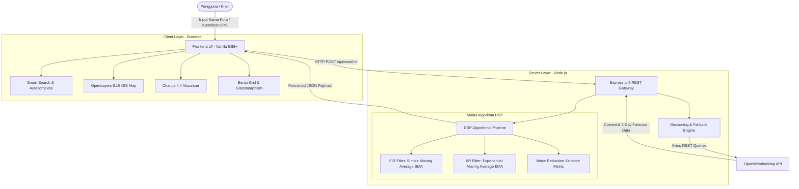

# Product Requirement Document (PRD)
## MeteoPulse — Interactive Weather Forecast & DSP Digital Filter Lab
**Proyek:** Portofolio Rekayasa Perangkat Lunak & Pengolahan Sinyal Digital (PSD)  
**Versi:** 2.0.0 (Production Ready)  
**Status:** Live & Implemented  
**Repositori:** `https://github.com/rzranz/WeatherApps`  

---

## 1. Executive Summary & Elevator Pitch

### 1.1 Ringkasan Produk
**MeteoPulse** adalah aplikasi web meteorologi modern yang memadukan penyajian prakiraan cuaca real-time dengan laboratorium komputasi **Pengolahan Sinyal Digital (DSP)**. Berbeda dengan aplikasi cuaca konvensional yang hanya menampilkan data mentah, MeteoPulse memperlakukan deret waktu temperatur sebagai **sinyal waktu diskrit $x[n]$** yang disaring menggunakan filter digital **Finite Impulse Response (FIR) Simple Moving Average (SMA)** dan **Infinite Impulse Response (IIR) Exponential Moving Average (EMA)** untuk meredam fluktuasi transien (*micro-climate noise*).

### 1.2 Elevator Pitch Portofolio (Untuk CV & Web Portfolio)
> *"MeteoPulse adalah dashboard meteorologi full-stack interaktif berbasis Node.js/Express dan Modern Vanilla JS dengan arsitektur Bento Grid 3-tingkat. Mengimplementasikan algoritma filter digital Low-Pass FIR (Simple Moving Average) dan IIR (Exponential Moving Average) untuk meredam fluktuasi transien suhu satelit hingga 70%, dilengkapi peta GIS OpenLayers interaktif, fitur komparasi multi-kota, serta ekspor data analitik CSV."*

---

## 2. Background & Problem Statement

### 2.1 Latar Belakang Masalah
1. **Fluktuasi Sensorik Mikro**: Data deret waktu cuaca (suhu, kelembapan, angin) dari satelit dan stasiun darat sering kali memiliki *noise* berupa lonjakan transien lokal yang mengaburkan tren iklim jangka pendek.
2. **Ketiadaan Konteks DSP pada Aplikasi Cuaca Umum**: Kebanyakan portal cuaca hanya menampilkan kurva mentah tanpa menyediakan pemahaman matematis mengenai pemrosesan sinyal atau filter peredam fluktuasi.
3. **Kebutuhan Komparasi Geografis**: Pengguna dan analis sering kali kesulitan membandingkan dinamika termal antar beberapa kota secara berdampingan dalam satu grafik analitik.

### 2.2 Solusi yang Dihadirkan
MeteoPulse menjembatani ilmu **Pengolahan Sinyal Digital (PSD)** dengan **Rekayasa Web Modern**:
- Menyediakan visualisasi perbandingan langsung antara **Sinyal Asli $x[n]$** vs **Sinyal Terfilter $y[n]$**.
- Menghitung **efisiensi reduksi noise (*Noise Reduction Ratio*)** secara real-time.
- Memungkinkan penyesuaian ukuran jendela filter ($M = 3, 4, 5, 6$) secara dinamis.
- Mengintegrasikan peta spasial interaktif OpenStreetMap dengan fungsi *reverse-geocoding*.

---

## 3. Product Architecture & Data Flow

---

## 4. Algorithmic Specifications (DSP / PSD)

### 4.1 Filter FIR: Simple Moving Average (SMA)
Simple Moving Average bekerja sebagai filter *low-pass* fasa-linear waktu diskrit:

$$y[n] = \frac{1}{M} \sum_{k=0}^{M-1} x[n-k]$$

- $x[n]$: Sampel temperatur mentah pada interval waktu $n$ (interval 3 jam dari sensor OpenWeatherMap).
- $y[n]$: Nilai temperatur hasil penghalusan (*smoothed signal*).
- $M$: Lebar jendela (*window size*), dapat diatur secara interaktif ($M \in \{3, 4, 5, 6\}$).

Fungsi transfer pada domain-Z:
$$H(z) = \frac{1}{M} \sum_{k=0}^{M-1} z^{-k} = \frac{1}{M} \frac{1 - z^{-M}}{1 - z^{-1}}$$

Respon frekuensi magnitudo filter berbentuk fungsi Dirichlet:
$$|H(e^{j\omega})| = \left| \frac{\sin(\omega M / 2)}{M \sin(\omega / 2)} \right|$$

Filter ini meloloskan frekuensi rendah (tren harian diurnal) dan menekan harmonik frekuensi tinggi (noise transien turbulensi udara).

### 4.2 Filter IIR: Exponential Moving Average (EMA)
Sebagai pembanding sistem berulang (*recursive filter*):

$$y[n] = \alpha \cdot x[n] + (1 - \alpha) \cdot y[n-1]$$

Dengan faktor pembobotan:
$$\alpha = \frac{2}{M + 1}$$

### 4.3 Metrik Efisiensi Reduksi Noise
Mengukur persentase penurunan kecepatan fluktuasi sinyal (*first-difference absolute variation*):

$$\text{Noise Reduction (\%)} = \left( 1 - \frac{\frac{1}{N-1}\sum_{i=1}^{N-1} |y[i] - y[i-1]|}{\frac{1}{N-1}\sum_{i=1}^{N-1} |x[i] - x[i-1]|} \right) \times 100\%$$

---

## 5. Functional Requirements (Fitur Aplikasi)

| ID | Modul / Fitur | Deskripsi Fungsional | Status |
| :--- | :--- | :--- | :--- |
| **FR-01** | **Hero Weather Master** | Menampilkan metrik real-time: suhu terkini, *feels like*, status cuaca dominan, kelembapan, kecepatan angin, tekanan atmosfer, jarak pandang, dan koordinat satelit. | ✅ Implemented |
| **FR-02** | **24-Hour Horizon Ribbon** | Pita 8 kartu prakiraan per jam (interval 3 jam) yang membentang penuh 12 kolom dengan persentase peluang hujan dan suhu SMA. | ✅ Implemented |
| **FR-03** | **Interactive OpenLayers GIS** | Peta interaktif berbasis OpenStreetMap dengan penanda radar berdenyut (*pulsing pin*), popup informasi instan, serta fitur **Klik Peta** untuk mendeteksi cuaca di titik mana saja di dunia. | ✅ Implemented |
| **FR-04** | **DSP Analysis Chart** | Grafik interaktif Chart.js dengan toggle Sinyal Mentah $x[n]$, Filter SMA $y[n]$, Filter EMA, serta selektor *Window Size* dinamis ($M = 3, 4, 5, 6$). | ✅ Implemented |
| **FR-05** | **5-Day Aligned Outlook** | Prakiraan harian dengan indikator visual *Temperature Range Bar* gradien dingin-ke-panas dengan garis sejajar vertikal. | ✅ Implemented |
| **FR-06** | **Multi-City Comparison** | Membandingkan dinamika hingga 5 kota secara simultan dengan pilihan parameter: Suhu Max, Suhu Min, Suhu Rata-rata, Curah Hujan, dan Angin. | ✅ Implemented |
| **FR-07** | **Smart Search & Autocomplete** | Input pencarian cerdas dengan saran otomatis dan *regex fallback* untuk nama kota Indonesia (`Kabupaten Bandung` $\rightarrow$ `Bandung`). | ✅ Implemented |
| **FR-08** | **Native GPS Geolocation** | Tombol pendeteksi koordinat perangkat klien satu-klik via browser Geolocation API tanpa reload halaman. | ✅ Implemented |
| **FR-09** | **Raw Data Audit & CSV Export** | Tabel numerik data mentah yang dapat difilter berdasarkan parameter dan tombol ekspor satu-klik berformat CSV. | ✅ Implemented |
| **FR-10** | **Theme Switcher** | Pengalih mode gelap (*Dark OLED / Deep Slate*) dan mode terang (*Clean White / Slate*) dengan status tersimpan di `localStorage`. | ✅ Implemented |

---

## 6. Non-Functional Requirements (Kualitas Sistem)

1. **Performa & Zero-Runtime Overhead**:
   - Memanfaatkan Modern Vanilla ES6+ tanpa kompilasi runtime framework berat (React/Vue/Angular), sehingga aplikasi memuat dalam kurun waktu `< 800ms`.
   - Ukuran CSS akhir hasil kompilasi Tailwind CSS CLI hanya berukuran `~49 KB`.
2. **Desain & Responsivitas (Bento Grid Architecture)**:
   - Tampilan adaptif di perangkat mobile (`< 768px`), tablet (`768px - 1024px`), dan desktop (`> 1024px`).
   - Menerapkan prinsip *Glassmorphism* dengan `backdrop-blur`, aksen cyan/emerald/amber, dan tipografi berbobot ganda.
3. **Data Integrity & Fallback**:
   - Menangani *network latency* atau kesalahan ketik nama kota dengan pesan kesalahan *inline* yang bersahabat tanpa *crash*.
4. **Deployability**:
   - Satu perintah tunggal `npm start` langsung menjalankan server Express yang menyajikan API sekaligus berkas frontend statis secara terpadu di port 3000.

---

## 7. Tech Stack Overview

- **Sisi Server (Backend)**: Node.js, Express.js 5, Axios, CORS.
- **Sisi Klien (Frontend)**: Vanilla JavaScript (ES6 Modules), HTML5 Semantic, Tailwind CSS v3.4, FontAwesome 6, Google Fonts (*Plus Jakarta Sans* & *JetBrains Mono*).
- **Library Analitik & Peta**: Chart.js 4.4, OpenLayers 6.15.
- **Penyedia Data**: OpenWeatherMap Geocoding & Weather Forecast API, OpenStreetMap Tile Server.

---

## 8. Showcase & Portfolio Talking Points

Saat mempresentasikan proyek ini pada sesi interview teknis atau portofolio:
1. **Highlight Rekayasa Sinyal**: Jelaskan bagaimana Anda menerapkan teori akademis Pengolahan Sinyal Digital (filter FIR Moving Average) ke dalam kasus nyata data deret waktu meteorologi.
2. **Kerapian Arsitektur**: Jelaskan mengapa Anda memilih *Modern Vanilla JS + Express 5* untuk menunjukkan penguasaan fundamental JavaScript (DOM, Events, Async, Modules, REST API) tanpa bergantung pada framework.
3. **Sentuhan UI/UX Kelas Dunia**: Tunjukkan struktur Bento Grid 3-tingkat yang simetris, keselarasan *baseline* pada prakiraan suhu 5 hari, serta integrasi peta GIS spasial.
